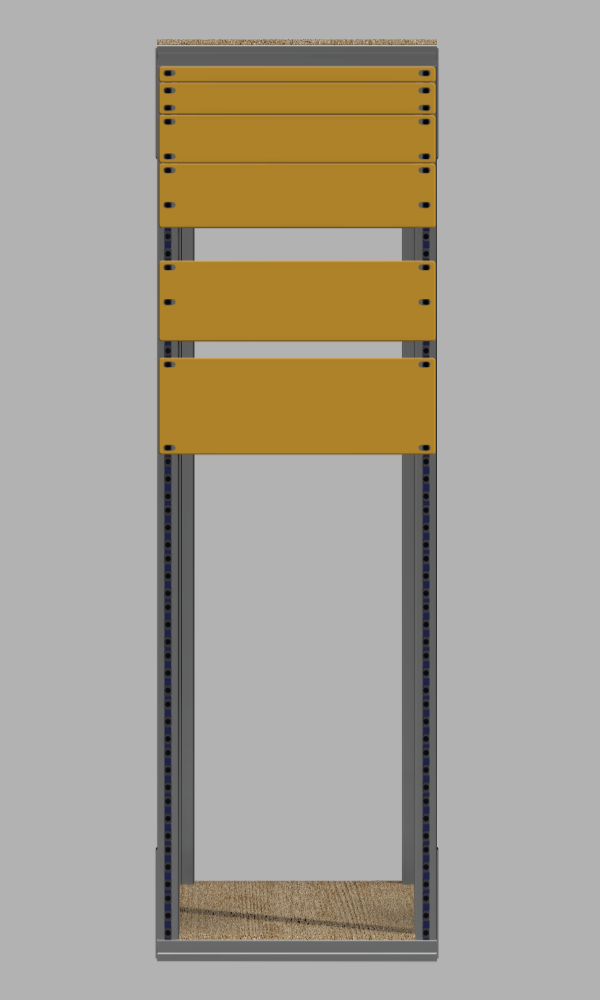
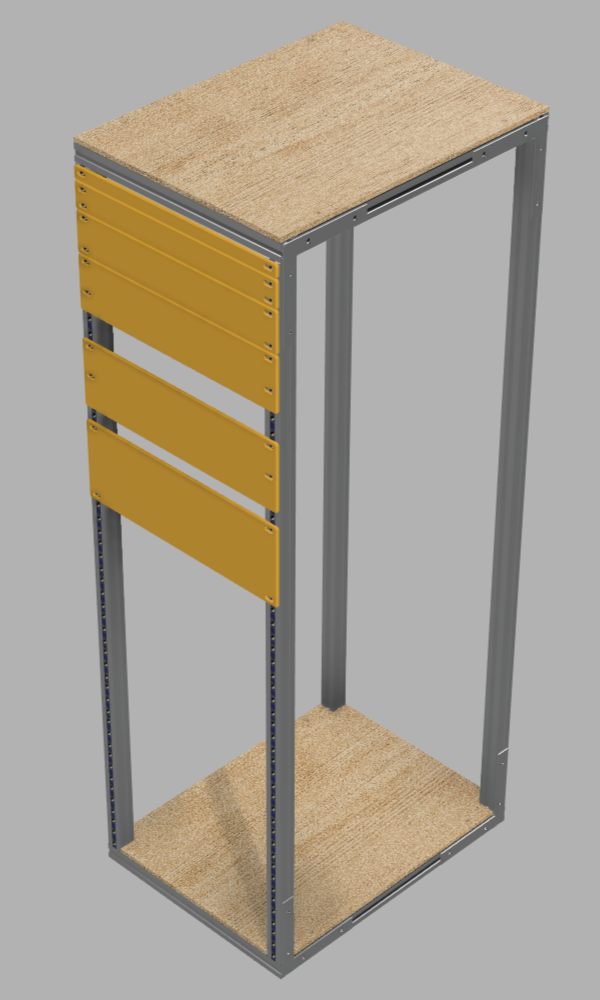
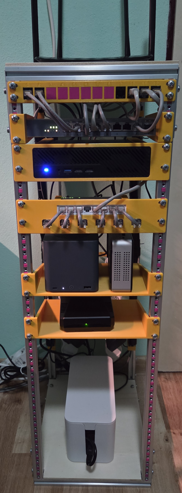

# Rack_2020-profiles
A parametric 10-inch rack designed in Autodesk Fusion 360 using 2020 aluminum extrusion profiles.

The design allows users to customize rack dimensions by modifying user parameters in Fusion 360, without manually adjusting individual components. While the model is intended to adapt automatically, not all parameter combinations have been tested.

The CAD model differs slightly from the physical build. Custom rack-mounted components are not included; instead, basic mounting plates are provided in the following heights: 1/3U, 2/3U, 1U, 4/3U, 5/3U, and 2U. These can serve as starting points for designing custom rack-mounted equipment.

## Table of Contents
- [Gallery](#gallery)
  - [Fusion 360 Design](#fusion-360-design)
  - [Physical Build (18U)](#physical-build-18u)
- [Customization](#customization)
  - [Main Parameters](#main-parameters)
- [CAD Files](#cad-files)
- [Bill of Materials (BOM)](#bill-of-materials-bom)
  - [Frame Assembly (Required)](#frame-assembly-required)
  - [Modular Accessories](#modular-accessories)
    - [Example: 18U Rack](#example-18u-rack)
- [Notes](#notes)

## Gallery
### Fusion 360 Design
<table>
  <tr>
    <td width="50%">
      
    </td>
    <td width="50%">
      
    </td>
  </tr>
</table>

### Physical Build (18U)

## Customization
The rack is designed to be parametric, allowing its dimensions to be adjusted without manually modifying individual components.

To customize the design:

1. Open the provided `.f3d` file in Autodesk Fusion 360.
2. Navigate to **Design → Solid → Modify → Change Parameters**.
3. Modify the relevant user parameters to match your requirements.
4. Allow Fusion 360 to recompute the model and verify that all components update correctly.

### Main Parameters
| Parameter | Default | Description |
|-----------|---------|-------------|
| `Rack_Height` | 18U | Rack height, defined as `Rack_Unit * 18` |
| `Rack_Depth` | 300 mm | Rack depth |
| `Rack_HoleSpacing` | 236.5 mm | Horizontal distance between mounting hole centers |
| `Rack_Width` | 256.5 mm | Overall rack width, calculated from hole spacing and profile dimensions |
| `Rack_Unit` | 44.45 mm | Height of one rack unit (U) |

To change the rack height, modify the multiplier in `Rack_Height`. For example, changing `Rack_Unit * 18` to `Rack_Unit * 12` produces a 12U configuration.

The remaining parameters control aluminum profile geometry, mounting brackets, T-nuts, and rack mounting plates. These generally do not need to be modified unless adapting the design to different hardware.

**Note:** Although the design is intended to adapt automatically, not all parameter combinations have been tested. Some configurations may require manual adjustments.

## CAD Files
The project is available in three formats:

| File | Format | Description |
|------|--------|-------------|
| `Rack.f3d` | Autodesk Fusion | Native parametric CAD model, recommended for customization |
| `Rack.3mf` | 3MF | 3D model for viewing, importing, or further processing |
| `Rack.zip` | Autodesk Inventor 2025 | ZIP archive containing Inventor assembly (`.iam`) and part (`.ipt`) files |

**Recommended:** Use `Rack.f3d` if you want to modify the rack dimensions using the provided parameters.

The other formats are provided for compatibility with different CAD software. Parametric functionality may not be preserved across formats.

## Bill of Materials (BOM)
### Frame Assembly (Required)
The following components are required to assemble the rack frame.

| Component | Quantity |
|-----------|---------:|
| 2020 Aluminum Profiles – Height | 4 |
| 2020 Aluminum Profiles – Width | 4 |
| 2020 Aluminum Profiles – Depth | 4 |
| Corner Brackets | 8 |
| L-Brackets | 8 |
| Wooden Top Desk | 1 |
| Wooden Bottom Desk | 1 |
| M5 T-Nuts | 40 |
| M5 Screws | 40 |
| M5 Washers | 40 |

### Modular Accessories
The following components are additional to the frame assembly hardware. Quantities depend on rack height and whether mounting rails are installed at the front, back, or both.

| Component | Quantity |
|-----------|----------|
| M5 T-Nuts | `U × 2 × 3 × S` |
| M5 Screws | Depends on installed mounting plates |
| M5 Washers | Depends on installed mounting plates |
| 3D-Printed Rack Units (1U) | `U × 2 × S` |

Where:
- `U` = Rack height in rack units
- `S` = Mounting faces (1 = front only, 2 = front and back)
- `2` = Left and right mounting positions
- `3` = T-nuts per rack unit, per side

#### Example: 18U Rack
| Component | Front Only | Front and Back |
|-----------|-----------:|---------------:|
| M5 T-Nuts | 108 | 216 |
| 3D-Printed Rack Units (1U) | 36 | 72 |

The number of screws and washers depends on the number, size, and mounting hole configuration of the installed equipment.

**Note:** The 3D-printed rack units are designed to stack vertically, forming continuous mounting rails. Therefore, the entire rack height must be populated with printed units, regardless of how much equipment is installed.

## Notes
- The Fusion 360 model serves as a reference for assembling the rack.
- Before printing all rack mounting components, it is recommended to print smaller sections to verify fit and adjust tolerances if necessary.
- The design has not been tested with every possible parameter combination.
- The project is licensed under the MIT License. See [LICENSE](LICENSE) for details.